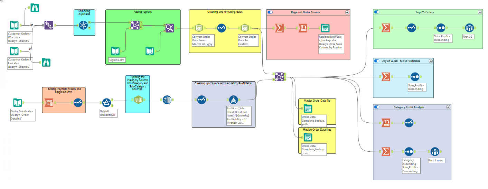

# Hi, I'm Juan Miguel Naval 👋

**Data Analyst | Business Intelligence Analyst | Data Engineer | Chemical Engineer**

I am a data professional with a background in chemical and process engineering, experienced in transforming operational and business data into actionable insights. I leverage **Python, SQL, Power BI, Tableau, Alteryx, and Excel** to perform data analysis, develop business intelligence solutions, and automate data workflows.

Combining analytical expertise with process engineering and Lean Six Sigma principles, I aim to bridge the gap between data and business operations by improving efficiency, identifying performance opportunities, and supporting data-driven decision-making.

---

## 📫 Connect With Me

📧 Email: navalmiguel98@gmail.com

💼 LinkedIn: https://linkedin.com/in/miguel-naval

💻 GitHub: https://github.com/MiguelNaval

---

# 🛠 Technical Skills

### Programming & Query Languages
- Python
- SQL
- MySQL
- Hive SQL

### Data Engineering & ETL
- Alteryx Designer
- Data Preparation and Transformation
- Data Blending and Integration
- ETL Workflow Development
- Data Cleansing and Validation

### Business Intelligence
- Power BI
- Tableau
- Power Query
- DAX

### Data Analytics
- Pandas
- NumPy
- Matplotlib
- Seaborn
- Microsoft Excel
- VBA

### Machine Learning
- Scikit-Learn
- Classification
- Feature Engineering
- Model Evaluation

---

# 📂 Featured Projects

---

## 📊 Alteryx Sales Data Analysis

End-to-end retail sales analytics project using Alteryx Designer to integrate, transform, and analyze customer and order datasets for profitability insights.

**Highlights**
- Data Integration and Blending
- Data Cleansing and Transformation
- Automated ETL Workflows
- Sales and Profitability Analysis
- Regional and Product Performance Analysis
- Automated Excel Reporting

**Tech Stack**

`Alteryx` `ETL` `Data Preparation` `Excel`

📷 Workflow Preview

🔗 Repository

https://github.com/MiguelNaval/Data-Analytics-Portfolio/tree/main/Alteryx-Sales-Data-Analysis

---

## 🍽️ Tasty Bytes Recipe Traffic Prediction

End-to-end machine learning project predicting high-traffic recipes using Python and Scikit-Learn.

**Highlights**
- Data Cleaning
- Exploratory Data Analysis
- Feature Engineering
- Classification Models
- Business Recommendations

**Tech Stack**

`Python` `Scikit-Learn` `Pandas` `Machine Learning`

📷 Preview

🔗 Repository

https://github.com/MiguelNaval/Tasty-Bytes-Recipe-Traffic-Prediction

---

## 📉 Fit.ly Subscriber Retention Analysis

Customer churn analysis using SQL and Python to identify churn drivers and recommend customer retention strategies.

**Highlights**
- SQL Analysis
- Customer Segmentation
- Statistical Analysis
- Business Recommendations

**Tech Stack**

`Python` `SQL` `Pandas`

📷 Preview

🔗 Repository

https://github.com/MiguelNaval/Fitly-Subscriber-Retention-Analysis

---

## 📊 Telecom Customer Retention Dashboard

Interactive Tableau dashboard analyzing customer churn across demographics, payment methods, contracts, and service plans.

**Highlights**
- Customer Analytics
- Interactive Dashboards
- KPI Reporting
- Geographic Analysis

**Tech Stack**

`Tableau` `Business Intelligence`

📷 Preview

🔗 Repository

https://github.com/MiguelNaval/Telecom-Customer-Retention-Dashboard

---

## 👥 Atlas Labs HR Analytics Dashboard

Interactive Power BI dashboard analyzing workforce demographics, employee performance, and attrition.

**Highlights**
- HR Analytics
- DAX
- Power Query
- KPI Dashboards
- Workforce Analytics

**Tech Stack**

`Power BI` `DAX` `Power Query`

📷 Preview

🔗 Repository

https://github.com/MiguelNaval/Atlas-Labs-HR-Analytics-Dashboard

---

# 🎓 Certifications & Licenses

### Data & Analytics
- DataCamp Certified Data Analyst
- DataCamp Certified Data Scientist
- DataCamp Certified Data Engineer

### Process Improvement
- Lean Six Sigma Master Black Belt

### Professional Licenses
- Licensed Chemical Engineer
- Licensed Chemical Technician
- Licensed Master Plumber

---

# 📈 Currently Learning

- Advanced SQL
- Machine Learning
- Power BI
- Cloud Analytics
- Advanced Data Engineering

---

⭐ Thank you for visiting my portfolio! Feel free to explore my repositories and connect with me on LinkedIn.
